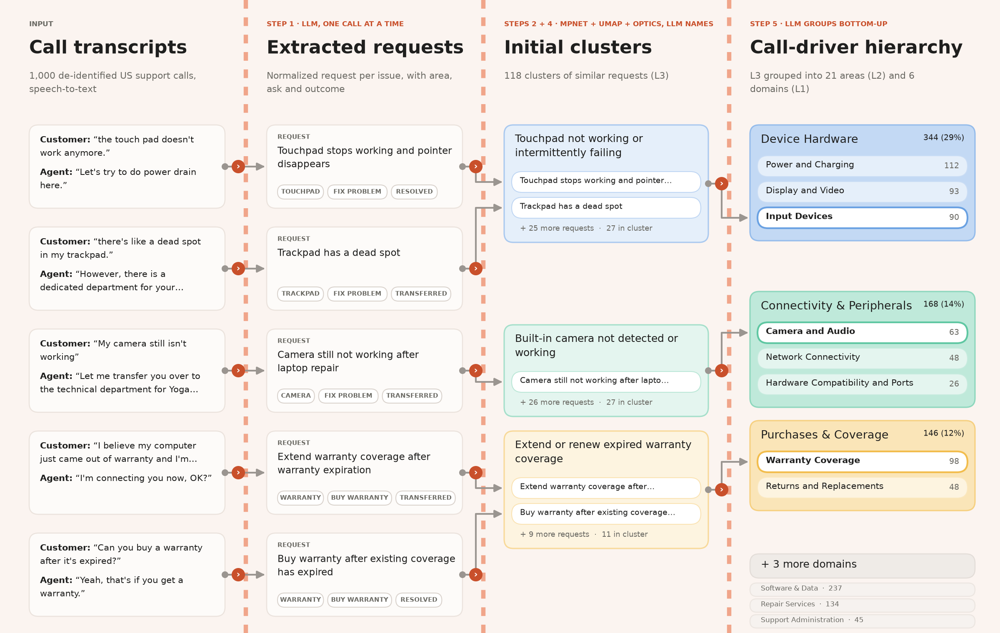

# Call-driver discovery pipeline

This pipeline finds out **why customers call Lenovo PC support** without a predefined category list. It reads call transcripts, extracts each customer request, clusters similar requests, and builds a three-level hierarchy of call drivers from the bottom up:

- **L1 (domain):** a broad area, e.g. *Device Hardware*
- **L2 (area):** a product or service area, e.g. *Input Devices*
- **L3 (issue):** a specific issue, e.g. *Touchpad not working or intermittently failing*

The design follows two published methods:

- **ChatMap** (Jiang et al., Findings of ACL 2025): extract request/solution pairs per dialogue, then cluster them with BGE embeddings and OPTICS.
- **Clio** (Anthropic, 2024): build a hierarchy bottom-up by naming fine clusters with an LLM, then grouping them into higher levels.



## Data flow

```text
data/Polaris_…_deidentified.csv            1000 calls, speech-to-text transcripts
        │
        ▼
step1_extraction   LLM, one call per transcript    → 1183 requests (request, category, ask, outcome, quotes)
        │
        ├──────────────────────────────┐
        ▼                              ▼
step2_clustering                    step3_taxonomy
mpnet → UMAP → iterative OPTICS     LLM, top-down reference taxonomy
→ 118 fine clusters                 (used only to validate step 5)
        │                              │
        ▼                              │
step4_naming                           │
LLM names clusters, 5 per call         │
→ 118 L3 categories                    │
        │                              │
        ▼                              │
step5_hierarchy  ◄─────────────────────┘
LLM groups L3 → L2 → L1, then validates against step 3
→ 6 L1, 21 L2, 118 L3, plus a label for every request
        │
        ▼
unsupervised/figures/pipeline_overview.png
```

Steps 3 and 2 both read step 1's output independently. Step 3 is not part of the main flow; it gives a top-down taxonomy that step 5 compares against.

## Steps

### Input: call transcripts

| | |
|---|---|
| File | `data/Polaris_Transcript_Only_Before_IVA_US_Oct_2025_random1000_deidentified.csv` |
| Contents | 1000 de-identified US calls. Columns: `genuuid`, `vcuuid`, `countrycode`, `intent`, `product`, `agentid`, `min_seg`, `start_time`, `end_time`, `turns`, `conversation` |
| Notes | `conversation` is speech-to-text with `Agent:` / `User:` lines. Expect misheard words (e.g. "Noble" for "Lenovo"), out-of-order turns, and placeholders like `[NAME]`. Transcript length is 41–38k characters, median about 3.2k. `intent` is 91% "ServiceRequest" and `product` is only Think/Idea, so neither is useful for grouping calls. |

### Step 1: Extraction (`unsupervised/step1_extraction/`)

Turns each transcript into a list of customer requests.

| | |
|---|---|
| Input | The transcript CSV (`product`, `intent`, `conversation` columns) |
| Method | One LLM call per transcript, using `extraction_prompt.md`. The model returns JSON only. Calls run in parallel: 8 workers by default, and the full run used `--workers 16` (about 5 minutes). |
| Model | `gpt-5.6-luna` (OpenAI); key in `.env` |
| Output | `result/extractions.json` |
| Script | `extract.py` |

For each request the model writes these fields:

| Field | Description |
|---|---|
| `request` | 5–15 words, problem first, generic: no names, model numbers or personal details. **This is the field that gets clustered.** |
| `category` | Free-text area in 1–3 words (e.g. "screen", "warranty"), based on the symptom, not the cause. |
| `request_type` | One of `fix_problem`, `check_warranty`, `buy_warranty`, `case_status`, `return_replace`, `setup_howto`, `purchase`, `account_admin`, `other` |
| `solution` | What the agent did, 5–20 words |
| `customer_quote`, `agent_quote` | Verbatim evidence from the transcript |
| `is_primary` | Exactly one request per call is the main reason for calling |
| `outcome` | `resolved`, `in_progress`, `transferred`, `out_of_scope` or `unresolved` |
| `has_troubleshooting` | `true` if the agent walked the customer through steps on the device for this request's symptom (power drain, check a light, update a driver, run diagnostics, remote session, ...). Only asking about the symptom, verification, or going straight to a repair or transfer does not count. |
| `troubleshooting_transcript` | When `has_troubleshooting` is true: the raw transcript lines of the troubleshooting, from the first instruction to the last reported result, joined with `\n` (separate parts joined with `\n...\n`). Otherwise `""`. `extract.py` replaces any line the model trimmed with the full transcript line, so the chunk is always whole raw lines. |

The prompt also defines what is not a request: greetings, identity or serial checks, holds, and clarifying follow-ups.

Results: 1183 requests from 1000 calls. 83 calls have no request (dropped, callbacks, or ended at verification). One call failed with an HTTP 403 from the API.

Run: `.venv/bin/python unsupervised/step1_extraction/extract.py [--limit 20] [--workers 16]`

Since 2026-11-19, extraction reuses `--out` (default `result/extractions.json`) when it exists, before reading the CSV or loading API credentials. It reports cached errors without retrying them. On a cache hit, `--csv`, `--limit`, and `--model` are ignored. Use `--refresh` to deliberately replace the cache, or a different `--out` for a separate dataset. Refresh requires the source CSV and API credentials. An invalid cache stops with an error rather than triggering API calls.

### Run elsewhere without the raw data

Copy the code and `unsupervised/step1_extraction/result/extractions.json` (already tracked in Git), then install the dependencies below. The `data/` folder is not needed for steps 2–5. The cache includes extracted requests, metadata, and evidence excerpts.

```bash
./run_pipeline.sh 1 2  # reuse extraction cache, then cluster and plot; no OpenAI key needed
./run_pipeline.sh 2    # cluster, name, and build hierarchy; API credentials needed for LLM steps
```

The embedding model must be downloaded on the destination machine or copied into its Hugging Face cache. To regenerate extractions when the raw CSV is available:

```bash
.venv/bin/python unsupervised/step1_extraction/extract.py --refresh --workers 16
```

### Step 2: Clustering (`unsupervised/step2_clustering/`)

Groups similar requests into fine clusters.

| | |
|---|---|
| Input | `unsupervised/step1_extraction/result/extractions.json`, the `request` field |
| Method | 1. **Embed** each request with all-mpnet-base-v2: no query prefix (the model is symmetric), normalized vectors, cosine distance.<br>2. **Reduce** the 768-dimensional vectors to 10 with UMAP (`n_neighbors=15`, `min_dist=0`, cosine, `random_state=0`).<br>3. **Cluster** with iterative OPTICS, following ChatMap §3.3: start at `min_samples=5`, then recluster only the unassigned points with `min_samples` one lower each round, until 80% of points are assigned or `min_samples` reaches 2. Leftover points are noise (label -1). |
| Model | `sentence-transformers/all-mpnet-base-v2` (runs on GPU; change with `--model`). Earlier runs used `BAAI/bge-large-en-v1.5`. |
| Output | `result/clusters_request.json` (clusters with members and outcome mix)<br>`result/clusters_request.npz` (embeddings, labels and texts, row-aligned) |
| Script | `cluster.py`; `plot.py` draws t-SNE scatter plots (`--all` colors every cluster) |

Results (from the earlier BGE run; not yet rerun with all-mpnet-base-v2): 118 clusters, 91% of requests clustered, median size 8, largest 27.

Run: `.venv/bin/python unsupervised/step2_clustering/cluster.py` then `.venv/bin/python unsupervised/step2_clustering/plot.py [--all]`

### Step 3: Reference taxonomy (`unsupervised/step3_taxonomy/`)

A **top-down** taxonomy, used only to check step 5. It is not part of the main flow.

| | |
|---|---|
| Input | `unsupervised/step1_extraction/result/extractions.json`, the `category` field (130 distinct strings) with counts and 3 example requests each |
| Method | One LLM call with `taxonomy_prompt.md`. The model uses its own knowledge of Lenovo PC support to propose 12–20 categories and map every observed `category` string to one of them. A second call maps any strings the first answer missed. |
| Model | `gpt-5.6-luna` |
| Output | `result/taxonomy.json` (categories plus the mapping), `result/taxonomy.md` |
| Script | `recommend.py` |

Run: `.venv/bin/python unsupervised/step3_taxonomy/recommend.py`

### Step 4: Cluster naming (`unsupervised/step4_naming/`)

Gives each step 2 cluster a name. These become the L3 categories.

| | |
|---|---|
| Input | `unsupervised/step2_clustering/result/clusters_request.json` and `.npz`. Noise is excluded. |
| Method | Clusters are ordered by hierarchical clustering of their centroids, then sent to the LLM **5 neighbouring clusters per call**, so similar clusters get distinct names. Each cluster shows up to 20 requests, most typical first (closest to its centroid). The prompt is `naming_prompt.md`. |
| Model | `gpt-5.6-luna`; 24 calls for 118 clusters |
| Output | `result/cluster_names.json`: `name` (3–8 words), `description` (1–2 sentences) and `coherence` (high/medium/low) for each cluster |
| Script | `name_clusters.py` |

Results: coherence was high for 76 clusters, medium for 40 and low for 2.

Run: `.venv/bin/python unsupervised/step4_naming/name_clusters.py`

### Step 5: Hierarchy (`unsupervised/step5_hierarchy/`)

Groups the 118 L3 categories into L2 and L1, labels every request with its L1/L2/L3, and checks the L2 level against the step 3 reference taxonomy.

| | |
|---|---|
| Input | `unsupervised/step4_naming/result/cluster_names.json` (L3 names, descriptions, sizes, coherence)<br>`unsupervised/step2_clustering/result/clusters_request.json` (which requests belong to which cluster)<br>`unsupervised/step3_taxonomy/result/taxonomy.json` (reference mapping, validation only) |
| Method | LLM grouping, bottom-up, one level at a time (default `--method llm`); Ward clustering as an alternative (`--method ward`). Details below. |
| Model | `gpt-5.6-luna`, JSON mode (`response_format=json_object`); `BAAI/bge-large-en-v1.5` as well for `--method ward` |
| Output | `result/hierarchy.json`, `result/hierarchy.md`, `result/labels.json`, `result/hierarchy.png`, `result/scatter_l2.png`; `*_ward.*` files are the same outputs from the Ward method, kept for comparison |
| Scripts | `build_hierarchy.py` (build and validate), `plot_hierarchy.py` (icicle chart), `plot_l2_scatter.py` (scatter by L2) |

#### LLM method (default)

`build_level_llm()` runs twice: L3 → L2, then L2 → L1. The children of one level become the input to the next, so L1 is built from the 21 L2 names and descriptions, not from the raw L3s.

1. **Prompt.** All children go into one call with `group_prompt.md`, largest first, one line each: `- id <id> (<request count>): <name>: <description>`. The prompt fills in:
   - `{level}`: "L2, the product or service area used for operational reporting" or "L1, the top-level domain used for executive reporting"
   - `{count_hint}`: "usually 12–25" for L2, "usually 3–6" for L1. This is guidance only; the prompt says not to pad or force a count.
   - `{name_rule}`: 2–5 words naming a product or service area for L2 (e.g. "Power & Charging"), 1–3 words naming a broad domain for L1.
2. **Rules given to the model.** Group by what the calls are about, not by shared wording. Use every child id exactly once. A one-child parent is allowed if the area is distinct. No catch-all parents ("Other", "Miscellaneous"). No brand or model names. Each parent gets a 1–2 sentence description specific enough to place a new call. Weight by request counts and do not invent areas.
3. **Clean-up of the answer.** Unknown ids are dropped. A child listed under two parents stays with the first. Parents left with no children are removed.
4. **Missing children.** Any child the model left out is sent to a second call (`assign_missing()`) that lists the proposed parents and asks for the single best parent for each missing child. If a child is still unassigned after that, the script stops with an error rather than writing a partial hierarchy.
5. **Sizes and order.** A parent's size is the sum of its children's request counts. Parents are sorted by size, and children within a parent by size; `id`s are the position after sorting.

This makes 2 LLM calls in the normal case (one per level), up to 4 if either level needs the follow-up call.

#### Ward method (`--method ward`)

`build_level()` runs twice with a **fixed** number of parents (`--l2`, default 20; `--l1`, default 5):

1. Embed each child's `"name: description"` with BGE (normalized) and cut a Ward agglomerative clustering into k groups.
2. Name the groups with `parent_prompt.md`, `--batch` groups per call (default 5, 8 calls in parallel). The model returns `name`, `description` and `misfits`: child ids that clearly do not belong with the rest of the group. It is told to name what the majority shares, not to stretch the name to cover a misfit.
3. One more call lists all parents and assigns each misfit to its best parent (`reassign_misfits()`). Each move is printed and recorded under `moves` in the output.

The LLM method replaced this one; see Design decisions for why.

#### Per-request labels

Every member of every step 2 cluster gets a row in `labels.json`: its L3 is its cluster's name, its L2 is that L3's parent, and its L1 is that L2's parent. Noise members (cluster -1) are kept with `L1`, `L2` and `L3` set to `null`, so the file has one row per request (1183).

#### Validation

Step 5 has no ground truth, so each L2 is compared with two independent signals from earlier steps:

- `top_step1_categories`: the 5 most common step 1 `category` strings (lowercased) among the L2's requests. A clean L2 is dominated by one or two related strings.
- `reference_category` and `reference_agreement`: each request's `category` is mapped to a step 3 reference category through `taxonomy.json`'s `mapping` (unmapped strings count as `?`). `reference_category` is the most common mapped category in the L2, and `reference_agreement` is the share of the L2's clustered requests that map to it.

The headline number is `reference_agreement` averaged over L2s weighted by L2 size. Step 3 was built top-down from a different field (`category`, not `request`) without seeing the clusters, so agreement is evidence that the bottom-up grouping matches how a support analyst would divide the calls. Low agreement flags an L2 for review; it does not prove the L2 is wrong, because the reference taxonomy is an LLM's guess too, and it divides some areas differently (e.g. it has one "Repair & Service Case" category where step 5 has three repair L2s).

#### Output files

| File | Contents |
|---|---|
| `hierarchy.json` | `model`, `method`, `n_requests`, `unclustered`, `moves` (Ward only; empty for LLM), and the lists `L1`, `L2`, `L3`. Each L1/L2 entry has `id`, `name`, `description`, `size`, `children` (ids at the level below) and `misfits`; each L2 also has `validation`. L3 entries carry the step 4 `name`, `description`, `size` and `coherence`. |
| `hierarchy.md` | Readable tree: L1 → L2 → L3 with counts and percentages of all requests, each L2's reference category and agreement, its top step 1 categories, and flags for low-coherence L3s and misfits. |
| `labels.json` | One row per request: `genuuid`, `request_idx`, `request`, `category`, `request_type`, `is_primary`, `outcome`, `L3`, `L2`, `L1`. Join to step 1 on (`genuuid`, `request_idx`). |
| `hierarchy.png` | Icicle chart from `plot_hierarchy.py`: three columns (L1, L2, L3), box height = request count, one hue per L1, plus a grey band for unclustered requests so the chart accounts for all 1183. |
| `scatter_l2.png` | From `plot_l2_scatter.py`: step 2's t-SNE layout (same settings as `unsupervised/step2_clustering/plot.py`) colored by L2. Hue = L1, shade = L2 within it, every L2 labelled on the plot, noise in grey. The script checks that the embedding rows and `labels.json` line up and stops if they don't. |

#### Results (LLM method)

1183 requests: 1074 labelled, 109 unclustered (9%). 6 L1, 21 L2, 118 L3. Size-weighted reference agreement 0.74 (Ward method: 0.73).

| L1 (requests) | L2 | Requests | L3s | Reference category | Agreement |
|---|---|---|---|---|---|
| Device Hardware (344) | Power and Charging | 112 | 12 | Power & Charging | 0.96 |
| | Display and Video | 93 | 10 | Display | 0.70 |
| | Input Devices | 90 | 8 | Keyboard, Touchpad & Pointing Devices | 0.92 |
| | Physical Device Damage | 32 | 3 | Repair & Service Case | 0.50 |
| | Thermal and Fan Issues | 17 | 3 | Thermal & Cooling | 0.94 |
| Software & Data (237) | Windows Startup and Recovery | 81 | 8 | Operating System & Applications | 0.42 |
| | Software and Account Access | 74 | 6 | Accounts, Access & Security | 0.51 |
| | Windows Software and Performance | 51 | 5 | Operating System & Applications | 0.78 |
| | Setup and Data Migration | 31 | 5 | Setup & Data Transfer | 0.45 |
| Connectivity & Peripherals (168) | Camera and Audio | 63 | 4 | Audio, Camera & Biometrics | 0.87 |
| | Network Connectivity | 48 | 6 | Network & Wireless Connectivity | 0.92 |
| | Hardware Compatibility and Ports | 26 | 3 | Ports & Expansion | 0.38 |
| | Docking Stations | 23 | 2 | Docks, Monitors & Accessories | 0.91 |
| | Printer Support | 8 | 1 | Docks, Monitors & Accessories | 0.62 |
| Purchases & Coverage (146) | Warranty Coverage | 98 | 13 | Warranty & Coverage | 0.99 |
| | Returns and Replacements | 48 | 5 | Returns, Replacement & Refunds | 0.54 |
| Repair Services (134) | Repair Logistics | 55 | 7 | Repair & Service Case | 0.84 |
| | Repair Case Management | 51 | 6 | Repair & Service Case | 0.90 |
| | Repair Service and Eligibility | 28 | 5 | Motherboard, Processor & Graphics | 0.25 |
| Support Administration (45) | Support Routing | 30 | 4 | Repair & Service Case | 0.57 |
| | Customer and Device Records | 15 | 2 | Accounts, Access & Security | 0.33 |

High agreement (≥ 0.9) on the hardware and service areas with clear boundaries. The low scores fall into two groups: L2s the reference splits differently, and L2s that are genuinely mixed. Examples of the first kind:

- *Windows Startup and Recovery* (0.42): its largest `category` is "bios" (19), which the reference files under Boot, BIOS & Firmware, and "windows login" (8) goes to Accounts, Access & Security.
- *Software and Account Access* (0.51): split almost evenly between "software" (33, Operating System & Applications) and "windows login" (31, Accounts, Access & Security).
- *Physical Device Damage* (0.50): "screen" (14) maps to Display and "hinge" (13) to Repair & Service Case. Step 5 groups them by symptom (physical damage).

Examples of the second kind: *Hardware Compatibility and Ports* (0.38: storage, USB, BIOS, charging) and *Repair Service and Eligibility* (0.25: warranty, motherboard, power-on). See Known limitations.

#### Options

| Flag | Default | Meaning |
|---|---|---|
| `--method` | `llm` | `llm` or `ward` |
| `--l2`, `--l1` | 20, 5 | Ward only: number of L2 / L1 groups |
| `--batch` | 5 | Ward only: groups named per LLM call |
| `--model` | `gpt-5.6-luna` | OpenAI chat model |
| `--encoder` | `BAAI/bge-large-en-v1.5` | Ward only: embedding model |
| `--names`, `--clusters` | step 4 / step 2 results | Input files |
| `--out` | `result/hierarchy.json` | Output path; `.md` and `labels*.json` are written next to it, with `labels` substituted for `hierarchy` in the file name |

To keep a Ward run alongside the LLM run, pass `--out result/hierarchy_ward.json`; otherwise the second run overwrites the first.

Run:

```bash
.venv/bin/python unsupervised/step5_hierarchy/build_hierarchy.py [--method ward --out unsupervised/step5_hierarchy/result/hierarchy_ward.json]
.venv/bin/python unsupervised/step5_hierarchy/plot_hierarchy.py [--input unsupervised/step5_hierarchy/result/hierarchy_ward.json]
.venv/bin/python unsupervised/step5_hierarchy/plot_l2_scatter.py
```

Because the LLM output varies between runs (see Known limitations), rerunning step 5 changes the L2/L1 names. Rerun `plot_l2_scatter.py` and the figure script afterwards, and update `L1_COLORS` in `unsupervised/figures/pipeline_overview.py` if the L1 names change.

### Figure (`unsupervised/figures/`)

`pipeline_overview.py` draws `pipeline_overview.png` in the style of the Clio paper's figure. It traces 5 real calls from transcript to L1, reading `extractions.json`, `labels.json` and `hierarchy.json`. Choose the traced calls with the `EXAMPLES` list. If step 5 renames an L1 category, update `L1_COLORS` to match.

## Where the LLM is used

| Step | LLM | Calls | Role |
|---|---|---|---|
| 1 extraction | yes | 1000 | Summarize each call into requests |
| 2 clustering | **no** | 0 | Embeddings, UMAP and OPTICS only |
| 3 reference | yes | 1–2 | Top-down taxonomy for validation |
| 4 naming | yes | 24 | Name clusters (5 per call) |
| 5 hierarchy | yes | about 2–4 | Propose and assign L2 and L1 |

## Design decisions

- **Cluster `request` only, not request + solution.** ChatMap embeds the whole pair because its goal is learning how agents respond, within topics the platform already labelled. Our goal is drivers, with no topic labels. A pair-mode test grouped calls by handling (e.g. "agent transferred the call"), dropped coverage from 91% to 85%, and was removed. `cluster.py --embed pair` still exists.
- **No clustering on `category`.** Short repeated labels break OPTICS: identical strings have zero distance, so identical labels split into separate clusters. `category` is kept for validation only.
- **UMAP before OPTICS.** Without UMAP: 198 clusters, 73 of them with 2 members, 70% clustered. With UMAP: 118 clusters, none with 2 members, 91% clustered.
- **LLM grouping in step 5 instead of Ward.** Ward groups by wording (it put touchpad with Wi-Fi because both said "intermittently") and must return a fixed number of groups (it forced 5 L1 groups). LLM grouping groups by meaning and chooses the number itself.
- **Categories by symptom, not root cause.** "Won't power on" is a power issue even if the cause turns out to be the motherboard. The customer and agent often don't know the cause during the call.

## Known limitations

- **LLM steps vary between runs.** Two step 5 runs agreed at ARI 0.71 on L2 and 0.65 on L1, and produced 21 vs 26 L2 and 6 vs 5 L1. The large areas (power, display, input devices, audio and camera, network, warranty, returns, repair logistics) are stable; boundaries between smaller areas shift. Before adopting the taxonomy, run step 5 several times and have a person review it.
- **A few L2 categories are still mixed,** e.g. "Hardware Compatibility and Ports" and "Repair Service and Eligibility".
- **The L1 level has three service-related groups** (Purchases & Coverage, Repair Services, Support Administration) that could reasonably be merged.
- **9% of requests are unclustered** (OPTICS noise) and have no labels.
- **One sample of 1000 calls.** Rare drivers (e.g. printers, 8 requests) rest on very few examples.

## Setup

```bash
python3 -m venv .venv
.venv/bin/pip install openai python-dotenv sentence-transformers scikit-learn umap-learn scipy matplotlib adjustText openpyxl
```

Versions used: openai 3.29.0, sentence-transformers 6.1.0, torch 2.14.1, scikit-learn 1.9.1, umap-learn 0.5.12, scipy 1.18.1, matplotlib 3.11.2, adjustText 1.4.0, openpyxl 3.1.5, Python 3.12.3.

LLM steps need `OPENAI_API_KEY` in the environment or the project's `.env`; cached extraction and clustering do not. Never commit `.env`. `.gitignore` excludes `.env`, `.venv/`, `__pycache__/` and `data/` (the raw transcripts); everything else, including each step's `result/`, is tracked.

Run order: step 1 → step 2 → step 3 → step 4 → step 5 → figure. Each script's defaults read the previous step's `result/` folder.

`run_pipeline.sh` at the project root runs them in that order: `./run_pipeline.sh [FROM] [TO]` (steps 1–5, default all). For example, `./run_pipeline.sh 2` reuses step 1's extractions and reruns clustering, naming and the hierarchy. Step 3 is skipped when FROM > 1 and `taxonomy.json` already exists, because it depends only on step 1. Step 1 reuses its cache by default; other steps overwrite results, so copy anything you want to keep first. After refreshing extractions, run from step 1 to rebuild the reference taxonomy too.
